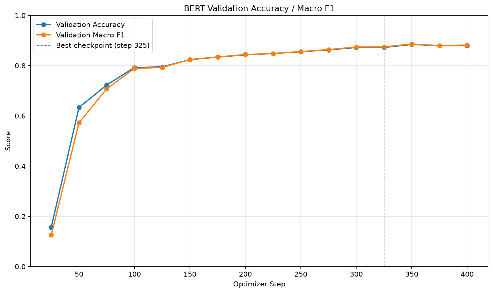

# 中文句子情緒分類（BERT 八類多元分類）

微調 `bert-base-chinese`，把一句中文對話分成 8 種情緒語調。
這份作業改寫自課程的 `bert_finetune` 範例，把原本的**二元分類**（正面 / 負面評論）改成**多元分類**（8 類情緒）。

## 訓練資料來源
- [Datasets: Johnson8187/Chinese_Multi-Emotion_Dialogue_Dataset](https://huggingface.co/datasets/Johnson8187/Chinese_Multi-Emotion_Dialogue_Dataset)
- 下載 `data.csv`，共 4,159 筆，欄位為 `text`（句子）、`emotion`（情緒標籤）

| 類別 id | 情緒 | 筆數（去重後） |
|:-:|---|--:|
| 0 | 厭惡語調 | 404 |
| 1 | 平淡語氣 | 704 |
| 2 | 悲傷語調 | 486 |
| 3 | 憤怒語調 | 527 |
| 4 | 疑問語調 | 386 |
| 5 | 開心語調 | 591 |
| 6 | 關切語調 | 559 |
| 7 | 驚奇語調 | 497 |

## 基礎模型
- [google-bert/bert-base-chinese](https://huggingface.co/google-bert/bert-base-chinese)

## 安裝套件
- Python 3.12.10
- torch 2.11.0+cu128
- transformers 5.20.1
- datasets 5.1.0
- accelerate 1.15.0
- safetensors 0.8.0
- scikit-learn 1.9.1
- pandas 3.0.6
- numpy 2.5.4
- matplotlib 3.11.2

```bash
# PyTorch 需依顯示卡選擇 CUDA 版本（RTX 50 系列需 cu128 以上）
pip install torch --index-url https://download.pytorch.org/whl/cu128
pip install -r requirements.txt
```

訓練環境：Windows 11、NVIDIA GeForce RTX 5070 Ti（16 GB），訓練約 40 秒。

## 說明

### 整體流程

```
data/data.csv
   │ prepare_data.py   ① 去除重複句子 ② 文字 label → 整數 id ③ 分層切成 80/10/10
   ▼
data/train.jsonl (3323)  valid.jsonl (415)  test.jsonl (416)  label_map.json
   │ train_bert.py     bert-base-chinese + 8 類分類頭，依 valid eval_loss 挑最佳 checkpoint
   ▼
output/  最佳模型
   ├─ evaluate_bert.py      test set 評估 + 混淆矩陣
   ├─ plot_bert_metrics.py  loss / accuracy / F1 曲線
   └─ infer_bert.py         預測作業指定的句子
```

### 二元分類 → 多元分類，改了什麼

| 項目 | 範例（二元） | 本作業（八類） | 原因 |
|---|---|---|---|
| label | 0 / 1 | 中文字串 → 0~7 | CrossEntropyLoss 只接受整數類別 index，用 `label_map.json` 固定對照 |
| `num_labels` | 2 | 8 | 分類頭從 `Linear(768→2)` 變成 `Linear(768→8)` |
| `id2label` | 寫死 NEGATIVE / POSITIVE | 從 `label_map.json` 讀 | 存進 `config.json`，推論時直接輸出「開心語調」而不是 `LABEL_5` |
| F1 | `average="binary"` | `average="macro"` | binary 只能用在兩類；macro 讓每一類權重相同，小類別表現差也看得出來 |
| 資料切分 | train / valid | train / valid / **test** | valid 被拿來挑 checkpoint 會偏樂觀，test 才是真正沒看過的資料 |
| `max_length` | 512 | 128 | 資料最長 92 字、平均 20 字 |
| learning rate | 1e-4 | 3e-5 | BERT 論文建議 2e-5～5e-5，小資料集用太大的 LR 容易破壞預訓練知識 |
| 混合精度 | FP16 | BF16 | RTX 50 系列支援 BF16，數值範圍和 FP32 相同，不需要 loss scaling |

Loss 不需要改：`num_labels > 1` 且 label 為整數時，模型自動使用 CrossEntropyLoss。

### 資料前處理的重點
- **去除重複句子**：原始資料有 5 句重複（其中 1 句只差前後空白）。如果同一句同時出現在 train 和 test，分數會被灌水，稱為資料洩漏（data leakage）。
- **分層抽樣（stratified split）**：三份資料的各類比例幾乎相同，例如「疑問語調」在三份中都約佔 9.3%。

### 訓練設定
| 參數 | 值 |
|---|---|
| epochs（上限） | 5 |
| batch size | 32 |
| learning rate | 3e-5，前 50 步 linear warmup，之後線性遞減 |
| weight decay | 0.01 |
| 驗證頻率 | 每 25 步 |
| 最佳模型挑選 | validation `eval_loss` 最低 |
| early stopping | 連續 3 次驗證沒有改善就停止 |

訓練在 step 400（約 3.85 epochs）觸發 early stopping，最佳 checkpoint 為 **step 325**。

## 執行方法

```bash
# 1. 把 data.csv 放到 data/，切分資料
python prepare_data.py

# 2. 微調 BERT（最佳模型存到 output/）
python train_bert.py

# 3. 用 test set 評估，產生混淆矩陣
python evaluate_bert.py

# 4. 畫訓練曲線
python plot_bert_metrics.py

# 5. 預測作業指定的句子
python infer_bert.py
```

## 成果

### 作業指定句子的預測結果

```
我每天都能跟她一起上學，我好開心！ => 開心語調 (0.9839)
最好的朋友要離開臺灣了，以後可能不容易再見面... => 悲傷語調 (0.9751)
我覺得我快不行了... => 悲傷語調 (0.9626)
剛剛收到研究所錄取的通知書！ => 開心語調 (0.9353)
今年的冬天好像比較晚來。 => 平淡語氣 (0.9769)
```

「收到研究所錄取通知」的第二名是驚奇語調（0.0512），和人的直覺一致：既開心又意外。

### Test set 評估（416 筆，訓練與挑模型都沒用過）

| 指標 | 分數 |
|---|--:|
| Accuracy | **0.8870** |
| Macro F1 | **0.8816** |

| 情緒 | Precision | Recall | F1 |
|---|--:|--:|--:|
| 厭惡語調 | 0.8250 | 0.8250 | 0.8250 |
| 平淡語氣 | 0.8873 | 0.8873 | 0.8873 |
| 悲傷語調 | 0.8824 | 0.9184 | 0.9000 |
| 憤怒語調 | 0.8519 | 0.8679 | 0.8598 |
| 疑問語調 | 0.9062 | 0.7632 | 0.8286 |
| 開心語調 | 0.9492 | 0.9492 | 0.9492 |
| 關切語調 | 0.9123 | 0.9286 | 0.9204 |
| 驚奇語調 | 0.8654 | 0.9000 | 0.8824 |

Test 分數（0.887）和 validation（0.870）接近，代表模型沒有只對 validation 表現好。

### 混淆矩陣


最常搞混的組合：
- **厭惡 ↔ 憤怒**（互相誤判各 4 次）：兩者都是高強度的負面情緒，例如「那個裁判真的很不公平」兩種解讀都合理。
- **平淡 → 悲傷**（5 次）：例如「昨天騎腳踏車的時候，我差一點就被車撞了。」標註為平淡，但內容偏負面。
- **疑問 → 平淡**（4 次）：疑問語調的 recall 最低（0.76），像「那什麼時候開始特訓呢？」語氣本身就很平。

檢查答錯的句子會發現有些是**標註本身模稜兩可**，例如「天啊！這是真的嗎？這不可能！」標為疑問語調、模型預測為驚奇語調。這類標註雜訊（label noise）限制了分數上限。

### 訓練曲線


- step 0～150：training loss 與 validation loss 一起快速下降。
- step 150 之後：training loss 持續下降到 0.1 左右，validation loss 卻持平在 0.46～0.5，是過擬合（overfitting）的訊號。
- step 325 之後 validation loss 回升，early stopping 在 step 400 停止，並載回 step 325 的最佳模型。



第一次驗證（step 25）的 accuracy 約 0.16，接近 8 類隨機亂猜的 1/8 = 0.125，因為分類頭一開始是隨機初始化的。

## 專案結構

```
.
├── data/
│   ├── data.csv            原始資料
│   ├── label_map.json      label ↔ id 對照表
│   ├── train.jsonl
│   ├── valid.jsonl
│   └── test.jsonl
├── fonts/
│   └── NotoSansTC-Regular.otf   混淆矩陣的中文字型
├── output/                 最佳模型（model.safetensors 使用 Git LFS）
│   ├── config.json
│   ├── model.safetensors
│   ├── tokenizer.json
│   ├── tokenizer_config.json
│   ├── trainer_state.json
│   ├── confusion_matrix.png
│   ├── loss_curve.png
│   └── metric_curve.png
├── prepare_data.py
├── train_bert.py
├── evaluate_bert.py
├── plot_bert_metrics.py
├── infer_bert.py
└── requirements.txt
```

## 補充：上傳大型模型檔

`model.safetensors` 約 390 MB，超過 GitHub 單檔 100 MB 上限，使用 [Git LFS](https://git-lfs.com/) 上傳：

```bash
git lfs install                    # 每台電腦只需執行一次
# .gitattributes 已設定：*.safetensors 交給 LFS 管理
git add .gitattributes output/
git commit -m "feat: 新增微調後的情緒分類模型"
git push
```
